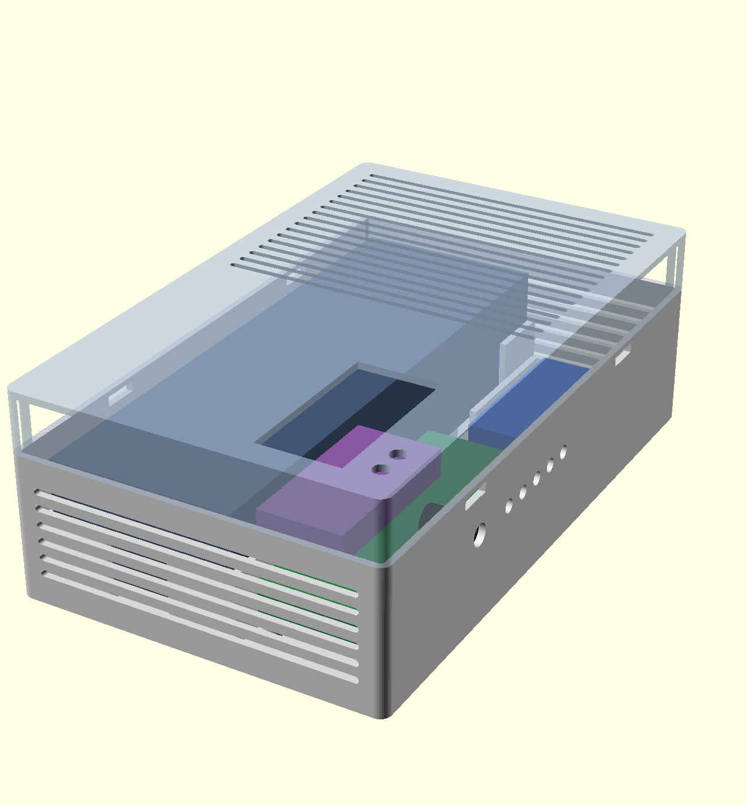

# 12 VDC UPS — 18650 4S5P

A compact DC uninterruptible power supply that delivers a regulated **12 V** to network equipment (fibre CPE, router, Wi-Fi hub) from a 24 V mains adapter, with seamless switchover to a **4S5P 18650 lithium-ion pack** when mains fails.

It's built around an off-the-shelf DC UPS module that does the charging, power-path switching, buck-boost regulation and battery undervoltage cutoff. Around it sit a balancing BMS, per-output fusing, and a 3D-printed PETG housing and cell harness (OpenSCAD sources included).

| Assembly | Plan |
|---|---|
|  |  |

_Renders of the housing design. Photos of the finished unit to follow._

> ⚠️ **Lithium-ion packs store a lot of energy (~250 Wh here) and can cause fires if built or used incorrectly.** This is a record of one build, not a certified product. Build at your own risk, and only if you are comfortable with spot-welding cells, pack wiring and DC fusing.

---

## Contents

- [Overview](#overview)
- [Specifications and operating limits](#specifications-and-operating-limits)
- [Runtime](#runtime)
- [Architecture](#architecture)
- [Bill of materials](#bill-of-materials)
- [Housing and harness (3D files)](#housing-and-harness-3d-files)
- [Build](#build)
- [Board configuration](#board-configuration)
- [Commissioning and testing](#commissioning-and-testing)
- [Operation and maintenance](#operation-and-maintenance)
- [Safety notes](#safety-notes)
- [Design rationale](#design-rationale)

---

## Overview

| | |
|---|---|
| Output | 12.0 V DC regulated, 5 fused outputs (5.5 mm barrel) |
| Input | 24 V DC, 4 A (96 W) external adapter |
| Battery | 20 × 18650 Li-ion, 4S5P, ~14.5 V nominal, ~17.5 Ah, ~254 Wh |
| Switchover | Zero-time; output stays regulated across mains loss and return |
| Protection | Board UVP + output OCP/short protection, Daly 4S BMS (per-cell OV/UV/OC/short + balancing), fused battery, input and outputs |
| Intended load | ~20–30 W of network equipment (e.g. CTS HES-3106-PLUS, MikroTik PowerBox Pro, Sagemcom Wi-Fi Hub 2) |

### Why 4S?

A 3S Li-ion pack spans 9.0–12.6 V and sits at ~11.1 V for most of its discharge, which is below 12 V. 4S spans 12.0–16.8 V. The UPS module's buck-boost regulator could run from either, but 4S halves the battery current for a given load compared with 2S, cuts it by about a quarter compared with 3S, and keeps the converter working in step-down mode for nearly the whole discharge. That means lower losses and less heat.

---

## Specifications and operating limits

### UPS module (as supplied)

| Parameter | Limit |
|---|---|
| Input voltage | 10–28 V DC; must be ≥ 1 V above the charge voltage to charge |
| Input current | 15 A max (fuse-limited) |
| Output voltage | 2–28 V adjustable, **set to 12.0 V** |
| Output current | 8.3 A continuous (100 W), 10 A peak |
| Output regulation / ripple | ±2%, < 80 mV p-p |
| Charge voltage | 4–23 V adjustable |
| Charge current | 0.5–5 A adjustable; terminates at 1/10 of set current |
| Efficiency | > 95% (charging and output conversion) |
| Standby current | < 200 µA |
| Operating temperature | −45 to +85 °C (board) |

### System limits (this build)

These come from the weakest component in each path, not from the module alone.

| Parameter | Limit | Set by |
|---|---|---|
| Output, on battery | **≤ 100 W continuous** (8.3 A) | UPS module |
| Output, on mains, while charging | **≤ ~50 W continuous** | 24 V 4 A adapter (96 W) minus ~43 W charging |
| Output, on mains, battery full | ≤ ~90 W | 24 V 4 A adapter |
| Per-output current | Fuse rating, max 5 A; barrel leads 18 AWG | Output fuses / cabling |
| Total output via fuse block | ≤ 10 A | Fuse block rating |
| Battery discharge current | ~8.5 A at 100 W out and 12.4 V cutoff (~1.7 A/cell) | Load; pack fuse 10 A, BMS 15 A, cells 10 A each |
| Battery charge current | **2.5 A** (0.14C, 0.5 A/cell) | Setting (VR1) |
| Charge voltage | **16.4 V** (4.10 V/cell) | Setting (VR2) |
| Undervoltage cutoff | **12.4 V** (3.10 V/cell) | Setting (VR4) |
| Restart threshold | **13.6 V** (3.40 V/cell) | Setting (VR3) |
| Cell charge temperature | 0–45 °C | Li-ion chemistry; **do not charge below 0 °C** |
| Cell discharge temperature | −20 to +60 °C | Li-ion chemistry |
| Enclosure ambient | Indoor, dry, ideally 10–30 °C | Housing material and cell life |

> **Note on the adapter:** the module doesn't appear to throttle charge current to protect the adapter. If your loads exceed ~50 W, use a **24 V 5 A (120 W)** or larger adapter, or reduce the charge current.

> **Note on "10 A":** the module's continuous rating is **8.3 A at 12 V**, with 10 A as a peak. Size loads accordingly.

---

## Runtime

Usable energy is about **195 Wh** at the output. That's 254 Wh nominal, less ~10% for charging to 4.10 V/cell rather than 4.20 V, a little for the 3.10 V/cell cutoff, and ~5% conversion loss.

| Load | Approx. runtime |
|---|---|
| 10 W | ~19 h |
| 20 W | ~10 h |
| 25 W | ~8 h |
| 30 W | ~6.5 h |
| 50 W | ~4 h |
| 100 W | ~2 h |

Real-world draw of network gear is usually well below adapter ratings. Measure yours with an inline DC meter.

---

## Architecture

```
 230 VAC ──► 24 V 4 A PSU ──► panel jack ──► [F1 5 A, inline] ──► UPS VIN+ / GND
                                                         │
                                                  ┌──────┴───────┐
                                                  │  UPS module  │  charge (CC/CV, buck)
                                                  │              │  power path (zero-time)
  4S5P pack ─► [F0 10 A, inline] ─► Anderson ─► BAT │              │  buck-boost 12.0 V out
     │                          ▲                 │              │  UVP / restart
     └─ Daly 4S BMS (B-/P-, balance leads)        └──────┬───────┘
                                                         │ VOUT 12 V / GND
                                                         ▼
                     6-way fuse block (12 V only) ─► F2…F6 ─► 5.08 mm edge conn (+)
                              UPS GND ──────────────────────► 5.08 mm edge conn (−)
                                                                  │
                                                                  ▼
                                                    5 × 5.5 mm barrel outputs
```

- **F0 (pack fuse)** sits on the pack positive, as close to the cells as practical, upstream of the Anderson connector. It protects the pack leads, BMS, connector and board input from a pack-fed short.
- The **BMS** switches the pack negative (B- to cells, P- to the Anderson). It is a **common-port** type: charge and discharge share P-.
- The **Anderson connector** is the battery service disconnect. Open it whenever you adjust charge voltage or work on the board.
- **Fuse block:** all six slots share one common bus, so it carries **only the 12 V outputs** (F2–F6). The 24 V input fuse (F1) is a separate inline holder. Putting F1 in the block would connect 24 V straight to the 12 V outputs.

---

## Bill of materials

Prices are as purchased (GBP, late 2026) and are indicative only.

| Qty | Item | Price (ea.) | Notes | Link |
|---|---|---|---|---|
| 1 | DC power supply 24 V 4 A / 5 A, 5.5/2.x barrel | £10.99 | Mains input. Must be ≥ 17.4 V (1 V above charge voltage). 4 A (96 W) covers ~50 W load while charging; use 5 A for heavier loads. | [AliExpress](https://www.aliexpress.com/item/1005007332397741.html) |
| 1 | DC UPS power module, 12 V out, 15 A max input | £36.79 | Main board: charger, power path, buck-boost regulator, UVP, LEDs | [AliExpress](https://www.aliexpress.com/item/1005001636977344.html) |
| 1 | Daly 4S 15 A BMS, 3.7 V Li-ion, common port, with balancing | £7.15 | Per-cell protection and passive balancing | [AliExpress](https://www.aliexpress.com/item/1005005995685641.html) |
| 1 | Blade fuse block, 2-input 6-output, 10 A, 15 cm leads | £4.99 | **12 V outputs only** (F2–F6, one spare). All slots share a common bus, so it must not carry the 24 V input. | [AliExpress](https://www.aliexpress.com/item/1005010116130521.html) |
| 2 | Inline blade fuse holder | — | F0 (pack positive, 10 A) and F1 (24 V input, 5 A). Rated ≥ 10 A with ≥ 18 AWG leads. | [AliExpress](https://www.aliexpress.com/item/1005009796880476.html) |
| n | DC blade fuses 1/2/3/5/10 A, 10 pcs | £0.93 | Name-brand recommended, with 1000 A DC interrupt rating, for the pack fuse | [AliExpress](https://www.aliexpress.com/item/4000832079230.html) |
| 1 | DC 5.5/2.x barrel panel connector, 10 A, 15 cm | £1.37 | Mains adapter input jack | [AliExpress](https://www.aliexpress.com/item/1005007189485497.html) |
| 5 | DC 5.5/2.x power leads, 18 AWG, 1.5 m | £3.26 | One per output. Match inner diameter (2.1 or 2.5 mm) to each device. 18 AWG is good to ~7 A. | [AliExpress](https://www.aliexpress.com/item/1005012145395888.html) |
| 2 | 16 mm LED indicator, panel mount, 3–6 V | £1.35 | External status LEDs via J8 (e.g. input power, charging/fault). A smaller size may fit better. | [AliExpress](https://www.aliexpress.com/item/1005008299613973.html) |
| 20 | LG MJ1 18650, 3500 mAh, 10 A | £2.81 | 4S5P, welded in a 10 × 2 honeycomb array | [Cell Supply](https://www.cellsupply.co.uk/lg-mj1-18650-battery) |
| 1 | 2-core 18 AWG silicone tinned copper wire | £1.60 | Internal hookup | [AliExpress](https://www.aliexpress.com/item/1005012526819544.html) |
| 1 | Anderson 30 A connector | £2.51 | Pack-to-board connection and safety disconnect | [AliExpress](https://www.aliexpress.com/item/1005006226687227.html) |
| 2 | 5-pin pluggable edge connector, 5.08 mm, 15 A | £0.88 | 1 × UPS negative fan-out to 5 outputs; 1 × fused positives to 5 outputs | [AliExpress](https://www.aliexpress.com/item/1005009224192771.html) |
| 1 | 3-pin 2.54 mm JST connector, PCB + lead | — | Detachable LED harness | — |
| — | Nickel strip, 10 mm × 0.15 mm | — | Cell interconnects and wire tabs | — |
| — | Spot welder | — | — | — |
| 20 | Fish-paper insulator rings, 18650 | — | One per cell positive terminal | — |
| — | Heat-resistant insulating tape, packaging | — | Pack wrap | — |
| 4 | M4 self-tapping screws | — | UPS module to base | — |
| 4 | M4 self-tapping screws | — | Wall mounting | — |
| 2 | M4 × 12 mm machine screws | — | Fuse holder | — |
| 1 | 3D-printed housing (base + cover), PETG | — | See below | — |
| 1 + 2 | 3D-printed cell harness: 1 footer + 2 spacers, PETG | — | See below | — |

**Approximate total:** ~£145 (parts listed with prices, excluding printing, tools and consumables).

---

## Housing and harness (3D files)

| File | Description |
|---|---|
| `housing_ups_12vdc.scad` | Parametric OpenSCAD source for the enclosure |
| `housing_ups_12vdc.3mf` | Print project for the enclosure |
| `housing_ups_12vdc_base.stl` | Enclosure base: UPS module, fuse block, connectors, pack |
| `housing_ups_12vdc_cover.stl` | Enclosure cover |
| `housing_ups_12vdc_assembly.png` | Assembly render |
| `housing_ups_12vdc_plan.png` | Top-down plan render |
| `18650-cell-pack-harness.scad` | Parametric OpenSCAD source for the cell harness |
| `18650-cell-pack-harness_footer.stl` | Cell footer: welding jig |
| `18650-cell-pack-harness_spacer.stl` | Cell spacer: structural (print 2) |

**Cell harness.** The honeycomb cells don't butt against each other, so the welded nickel shouldn't be the only thing holding the pack in shape.
- **Footer:** the cells stand in it during welding, which holds them square and level so the strips sit flat across all ends.
- **Spacers (×2):** slid over the cells, one about 10 mm from the top and one about 10 mm from the bottom. They fix cell spacing and make the pack rigid independently of the welds, so handling and mounting loads aren't taken through the weld nuggets.

**Material:** all parts are printed in **PETG**. PLA softens at ~55–60 °C, and the enclosure sits next to a pack and a converter for years. No common printed plastic is fire-rated. Consider where the unit is mounted (see [Safety notes](#safety-notes)).

> The housing SCAD/STL is being revised to mount the inline fuse holders (F0, F1); the renders may not show them yet.

---

## Build

### 1. Cells
- Buy all cells from a reputable supplier in one batch. Counterfeit cells are common.
- Check each cell's voltage on arrival. Group cells so each parallel group is within **~0.05 V**, and preferably match groups by capacity.
- Fit fish-paper insulator rings on positive terminals. The positive cap and the can (negative) are millimetres apart.

### 2. Pack (4S5P)
- Stand the 20 cells in the **footer** as a 10 × 2 honeycomb, forming four parallel groups of five, and fit the two **spacers** (~10 mm from each end).
- Spot-weld 0.15 mm nickel. Don't solder directly to cells.
- Main leads: crimp 18 AWG to nickel tabs, then weld the tabs to the pack ends.
- Balance leads: weld to B0 (pack −), B1, B2, B3 and B4 (pack +). **Before covering,** measure B0→B1, B1→B2 and so on in sequence. Each step must read one group's voltage (~3.6–3.7 V as received), and B0→B4 the full pack voltage.
- Strain-relieve all leads so they can't flex at the weld.
- Wrap in heat-resistant tape, leaving the pack fuse holder and Anderson connector outside the wrap.

### 3. BMS (Daly 4S, common port)
- Cells' negative → **B-**. BMS **P-** → Anderson negative.
- Follow Daly's connection order: B- first, then check balance lead voltages with a multimeter, then plug in the balance connector last. Wrong balance lead order is the most common way to destroy a BMS.
- Some Daly boards hold P- off until a charger voltage is applied. If you read 0 V at P-, connect the 24 V adapter once to wake it.

### 4. Pack fuse and disconnect
- **F0: 10 A blade fuse** on the pack positive, in a sealed inline holder, as close to the cells as practical, then to the Anderson positive.
- Use a name-brand DC blade fuse. Voltage rating ≥ 24 V DC (pack max is 16.8 V), and interrupt rating ~1000 A DC.

### 5. Fusing
- **F1 (24 V input): 5 A in an inline holder** between the adapter jack and UPS Vin+. That suits a 4 A adapter; a 10 A fuse here would protect only the wiring.
- **The 6-way fuse block carries 12 V outputs only.** Its slots share a common bus, so the 24 V input must never go through it. Feed the block's input lead from UPS VOUT.
- F2–F6 (12 V outputs): size to each device, roughly 1.5–2× its normal draw and ≤ its adapter rating:

| Output | Example device | Fuse |
|---|---|---|
| 1 | CTS HES-3106-PLUS (12 V 1.5 A adapter) | 2 A |
| 2 | MikroTik PowerBox Pro (no PoE out) | 3 A (5 A if feeding PoE devices) |
| 3 | Sagemcom Wi-Fi Hub 2 | 3 A |
| 4–5 | Spare | as required |

### 6. Wiring
- 18 AWG silicone throughout. Battery-side current is ≤ ~3 A normally and ≤ ~8.5 A worst case.
- Adapter jack → F1 (inline) → UPS **Vin+**. Jack negative → UPS input **GND**.
- UPS **VOUT** → fuse block input → F2–F6 → positive edge connector → barrel centre pins.
- UPS output **GND** → negative edge connector → barrel sleeves.
- Pack (via F0 and Anderson) → UPS **BAT** terminals (J1).
- LEDs → J8 via the 3-pin JST lead (J8 carries LED1–LED3).

### 7. Jumpers
- **J5 closed** (start switch) and **J7 shorted** (auto-start). Together these make the module start automatically whenever input power returns or the battery recovers above VSTART. Unattended operation needs this.
- **J6** left unset (mode 0). It's only used when the load is a PC motherboard.

---

## Board configuration

| Setting | Target | Adjust | How |
|---|---|---|---|
| Charge voltage | **16.4 V** (4.10 V/cell) | VR2 | **Battery disconnected.** Measure at the BAT terminals. The output pulses while detecting a battery; set the *peak* to 16.4 V. Counterclockwise raises. |
| Charge current | **2.5 A** | VR1 | Battery connected and partly discharged, ammeter in series with BAT+. Counterclockwise raises. |
| Undervoltage cutoff (VUVP) | **12.4 V** | VR4 | VUVP = 4 × V(TP4) → TP4 = **3.10 V** |
| Restart threshold (VSTART) | **13.6 V** | VR3 | VSTART = 4 × V(TP3) → TP3 = **3.40 V** |
| Output voltage | **12.0 V** | VR5 | J5 closed, no loads connected, measure at output |

Factory defaults are for 3S (12.6 V charge, 1 A, 9.0 V UVP, 9.6 V start, 12 V output). **Never connect a 4S pack before raising the charge voltage**, or it will charge incorrectly. And never adjust the charge voltage with any battery connected.

Why these values:
- **16.4 V / 4.10 V per cell:** a UPS pack sits at full charge almost permanently. Trading ~10% capacity for a lower float voltage substantially extends cell life.
- **2.5 A:** gentle (0.5 A per cell). It recharges from empty in ~7–8 h and keeps total adapter load within 96 W.
- **12.4 V cutoff:** well above the BMS's own over-discharge trip, so the BMS is a backstop rather than the normal cutoff. Also little capacity is left below ~3.1 V/cell under load.
- **13.6 V restart:** enough hysteresis that a rested pack recovering after cutoff doesn't make the output cycle on and off.

---

## Commissioning and testing

1. **Pre-power checks:** pack, BMS and balance leads verified (Build steps 2–3). Confirm with a continuity tester that there's no path from the 24 V input (jack, F1, Vin+) to the 12 V output bus. Anderson open. No loads connected.
2. **Adapter only:** connect the 24 V adapter. LED1 (blue, input) lights.
3. **Set the charge voltage** (VR2) to 16.4 V peak at the BAT terminals.
4. **Set the thresholds:** TP4 = 3.10 V (VR4), TP3 = 3.40 V (VR3).
5. **Set the output:** J5 closed, J7 shorted. Set VOUT to 12.0 V (VR5). LED4 (output) lights.
6. **Connect the battery:** close the Anderson. Wake the BMS if needed. Charging starts; LED3 (green) lights.
7. **Set the charge current** (VR1) to 2.5 A with an ammeter in series. Do this with the pack partly discharged, or the reading won't be accurate.
8. **Switchover test:** connect a dummy or real load. Pull the adapter. VOUT must stay at 12.0 V with no reset of connected equipment. Restore the adapter and confirm charging resumes.
9. **Full charge:** confirm termination (LED3 off, LED2 red on) at 16.4 V with current tapering to ~0.25 A.
10. **Runtime / UVP test (recommended once):** run on battery under normal load until cutoff. Confirm the output switches off near 12.4 V pack voltage and the BMS has *not* tripped. Restore mains and confirm auto-restart and recharge.
11. **Balance check:** after a full charge, measure each group. They should be within ~0.02 V.

---

## Operation and maintenance

- **Indicators:** LED1 blue = input present. LED3 green = charging; flashes when the battery is below VSTART, or flashes twice when it's below VUVP at start-up. LED2 red = charge complete. LED4 red = output on.
- **After an outage,** the module recharges automatically. A full recharge from cutoff takes ~7–8 h at 2.5 A.
- **Every 6–12 months:**
  - Check group balance (pack within ~0.02 V).
  - Check the enclosure for heat discolouration and the connectors for looseness.
  - Do a short discharge test to confirm runtime hasn't fallen significantly.
- **Storage:** if the unit will be unpowered for weeks, store the pack at ~3.7–3.8 V/cell (~15 V) and open the Anderson to remove BMS and board standby drain.
- **Retirement:** replace the pack if runtime drops below ~70% of new, or if any group drifts persistently out of balance.

---

## Safety notes

- **Fusing:** every source is fused: pack (F0, 10 A, inline), adapter input (F1, 5 A, inline), each output (F2–F6, fuse block). The pack fuse is the critical one. A 254 Wh pack can source hundreds of amps into a short.
- **Disconnect** the battery (Anderson) before any work on the board, wiring or settings.
- **Never charge below 0 °C.** Lithium plating causes permanent damage and internal shorts. Don't install in unheated outbuildings or lofts without accounting for this.
- **Location:** mount on a non-combustible surface, away from soft furnishings, with airflow around the enclosure. A printed enclosure provides no fire containment.
- **Cell abuse:** don't mix cells of different type, age or state of charge. Discard any cell that is dented, has torn wrap, or self-discharges noticeably.
- **Polarity:** the module isn't documented as reverse-polarity protected on the battery input. Check polarity before closing the Anderson.

---

## Design rationale

- **Integrated UPS module vs separate charger + buck:** an earlier candidate module (UPS-0528-11) passes the input voltage straight through to the output on mains (24 V) and outputs unregulated battery voltage on outage. It would have needed a separate wide-input buck converter and a low-voltage disconnect. The chosen module integrates a 100 W buck-boost regulator and adjustable UVP with restart hysteresis.
- **4S over 3S:** lower battery current and a near-continuous buck-mode regulator. 3S would also work with the module's factory settings at this load.
- **5P:** ~8 h runtime for ~25 W of network equipment, with each cell working at < 0.5 A typical.
- **Separate BMS:** the module only monitors total pack voltage. The Daly BMS adds per-cell over- and undervoltage protection, short-circuit protection and balancing.
- **24 V adapter:** gives the 1 V headroom the step-down charger needs above 16.4 V. Lower-voltage adapters (19 V) would also work and reduce conversion spread slightly.

---

## Licence

_TBD — add a `LICENSE` file (e.g. CERN-OHL-P / CC-BY-SA for hardware, MIT for code)._
